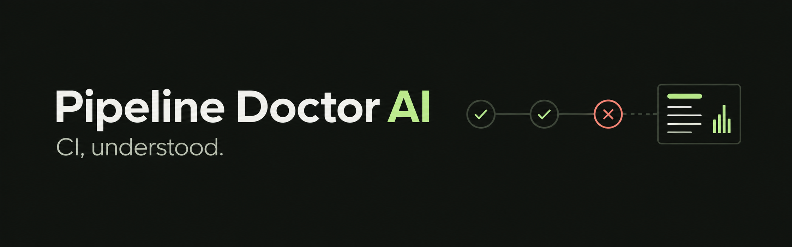
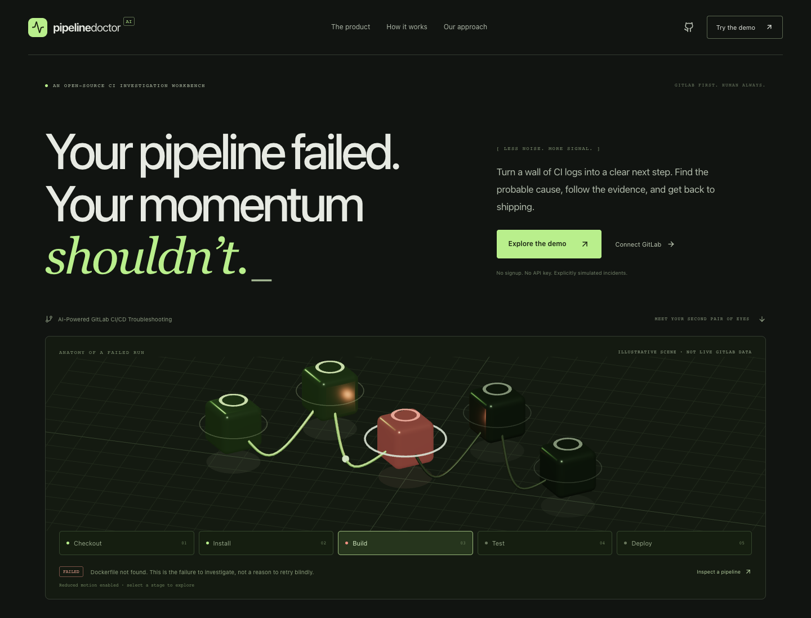
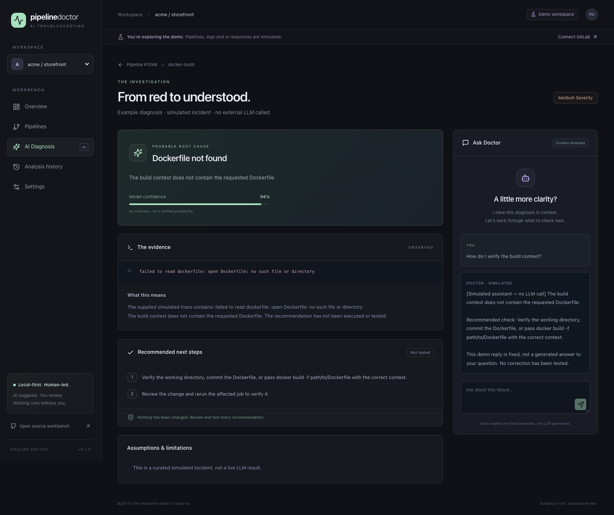
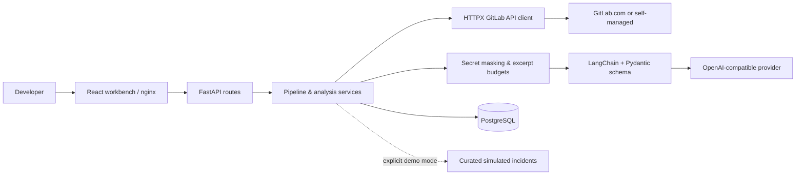

<div align="center">



#  Pipeline Doctor AI
### AI-Powered GitLab CI/CD Troubleshooting

**Less firefighting. More shipping.**

An open-source investigation workbench that turns failed GitLab jobs into evidence-backed diagnoses — without handing an AI the keys to your infrastructure.

**Public website = landing + simulated demo. Real GitLab pipelines run in your local installation.** No GitLab account, backend or provider key is needed for the public demo. See [the public/local split](docs/public-site.md).

[](https://github.com/Yeezayy/pipeline-doctor-ai/actions/workflows/ci.yml)


[](LICENSE)

[Quick start](#quick-start) · [Live integration](#connect-a-real-gitlab-project) · [Architecture](docs/architecture.md) · [Security](SECURITY.md) · [Roadmap](#roadmap)

[Public demo](https://pipeline-doctor.jordybarrere.dev/)

</div>



[View the demo dashboard](docs/screenshots/dashboard.png) · [View a diagnosis](docs/screenshots/diagnosis.png)

## Why this exists

A red pipeline rarely explains itself. The important line is buried in runner noise, the job image changed three commits ago, and “retry” is not a diagnosis. Pipeline Doctor puts the job trace, a structured explanation and a contextual assistant in one focused workspace.

This is a **functional, local-development MVP**, not an autonomous repair agent or a hosted multi-tenant service. Demo data is always labeled. Connect your own GitLab account to browse real pipelines; an LLM provider key is required only for live diagnosis and chat.

## What works today

- **GitLab connection:** paste a pipeline URL to connect its project and open the run directly, or discover accessible member projects and browse paginated pipelines. Inspect details and jobs, fetch traces and the root `.gitlab-ci.yml` at the pipeline's immutable commit.
- **Personal accounts:** GitLab OAuth + PKCE, encrypted server-side tokens, HttpOnly sessions, CSRF protection and per-user ownership. The GitLab.com public client is registered; self-managed instances need their own: [OAuth guide](docs/gitlab-oauth.md).
- **Public landing:** a SaaS-style presentation, actual demo captures and entry points to the workbench or account login. The dashboard lives at `/dashboard`.
- **Interactive 3D:** a Three.js pipeline illustration built with React Three Fiber and Drei. Select stages, orbit and pause motion. It is illustrative, not live GitLab data. The renderer is lazy-loaded, motion stops off-screen/in background tabs, reduced motion is respected, and an accessible fallback works without WebGL.
- **Structured AI diagnosis:** probable root cause, severity, confidence estimate, exact evidence excerpts, hypotheses, explanation and recommended fixes, validated with Pydantic through LangChain.
- **Contextual chat:** follow-up questions using the selected diagnosis, pipeline metadata and recent conversation; no claim of access to the full original trace.
- **History:** persistent analyses and conversations, individual deletion and configurable retention.
- **Focused UI:** responsive dark workbench, project switching, pipeline status filters, current-page search by branch/commit/pipeline ID, loading/error/empty states and explicit demo/live labels.
- **Shareable log excerpts:** copy exactly the sanitized trace displayed in the workbench, with explicit feedback when clipboard access is unavailable. Masking is best effort; review the excerpt before sharing it.
- **Local safety defaults:** server-side credentials, secret masking, log budgets, optional application API key, loopback-only published ports and no automatic execution or repository writes.
- **Reproducible demo:** six curated incidents, deterministic example diagnoses and explicitly fixed example chat replies. No GitLab account or paid API required.



## Quick start

### Docker Compose — connect your GitLab account (recommended)

Requirements: Git, Docker Engine/Desktop running, Docker Compose **2.24+**, and a GitLab.com account.

```bash
git clone https://github.com/Yeezayy/pipeline-doctor-ai.git
cd pipeline-doctor-ai
docker compose -f compose.yaml -f compose.local.yaml up --build -d
```

1. Open **http://localhost:8080**.
2. Click **Continue with GitLab** and authorize your account on GitLab.
3. In **Settings → Connect a project**, choose a project you can access.
4. Open **Pipelines**, select a pipeline and inspect its jobs and logs.

Already have the failing pipeline link? Open **Pipelines**, paste its GitLab URL (for example, `https://gitlab.com/group/project/-/pipelines/123`) and click **Open pipeline**. The app checks your access, connects that project to your workspace and opens the run directly, even if it is outside the current list page. URLs must belong to the configured GitLab instance. This shortcut is available in live mode and needs no LLM key.

**No `.env`, personal access token or client secret is needed for this GitLab.com login.** The public OAuth Application ID is included in the repository. GitLab browsing works without an LLM key; configure one below to use live diagnosis and chat. Self-managed GitLab needs its own application registration: [OAuth guide](docs/gitlab-oauth.md#simplified-local-account-login-public-client--pkce).

**Use `http://localhost:8080` consistently.** The registered callback is `http://localhost:8080/api/auth/gitlab/callback`; using `127.0.0.1` or another port can break the login flow.

- App and account settings: **http://localhost:8080/settings**
- API docs: **http://localhost:8000/docs**
- Health: **http://localhost:8000/health** (includes a database connectivity check)

Compose waits for PostgreSQL, runs a one-shot Alembic migration, then starts the API and nginx frontend. The database is not published on a host port. All published application ports bind to `127.0.0.1`.

Keep both Compose files in commands that start or recreate the GitLab account edition:

```bash
docker compose -f compose.yaml -f compose.local.yaml ps
docker compose -f compose.yaml -f compose.local.yaml logs --tail=100 -f backend
docker compose -f compose.yaml -f compose.local.yaml down
```

`down` preserves saved analyses and the local OAuth encryption key. **Do not use `down -v` unless you intend to delete the database and encryption-key volumes.** Back up both volumes together if you need to retain encrypted GitLab credentials.

### Docker Compose — demo without a GitLab account

From the repository root, with no `.env` or with `AUTH_MODE=local` and `DEMO_MODE=true` in an existing `.env`:

```bash
docker compose up --build -d
```

Open **http://localhost:8080**. This starts simulated pipelines, diagnoses and chat, with no account or provider key required. **Plain `docker compose up` uses demo defaults; it does not enable GitLab account login.** See [Try the demo](#try-the-demo) for a guided example.

### Common startup and login problems

- **No GitLab login / only demo pipelines:** start with both `compose.yaml` and `compose.local.yaml`, using the recommended command above. Existing demo data is not converted into live projects.
- **GitLab rejects the callback or the session fails:** open `http://localhost:8080` and start login again. The registered callback must match the scheme, hostname and port exactly.
- **OAuth token exchange returns `invalid_client`:** the OAuth application must have **Confidential unchecked**. This is a maintainer-side GitLab registration setting; see the [OAuth guide](docs/gitlab-oauth.md).
- **GitLab works but diagnosis/chat fails:** configure the [LLM provider](#configure-live-diagnosis-and-chat) and recreate the backend with both Compose files.
- **App does not open:** run the `ps` and backend log commands above. Docker must be running; the frontend starts only after migrations succeed and the backend is healthy.
- **Port 8000 is occupied:** use `BACKEND_PORT=8001 docker compose -f compose.yaml -f compose.local.yaml up --build -d`. API docs and health then use port 8001; the app and OAuth callback stay on port 8080.

### Without Docker — contribution loop (demo by default)

Requirements: [uv](https://docs.astral.sh/uv/), Python 3.12+, Node.js 24 LTS and npm. SQLite is an intentional **local-development fallback**; PostgreSQL is the Compose/CI database.

Terminal 1, from the repository root:

```bash
cd backend
uv sync --frozen --python 3.12
uv run alembic upgrade head
uv run uvicorn app.main:app --host 127.0.0.1 --port 8000 --reload --no-access-log
```

Terminal 2, from the repository root:

```bash
cd frontend
npm ci
npm run dev
```

Open **http://127.0.0.1:5173**. Vite proxies `/api` and `/health` to the local backend. The root `.env` belongs to Compose; for a non-Docker backend, export environment variables or create an ignored `backend/.env`. Its defaults are demo mode and `sqlite:///./doctor.db`. Run Alembic against the same `DATABASE_URL` used by the API.

## Try the demo

1. Leave `DEMO_MODE=true` (the default).
2. Open **Pipelines** and inspect pipeline **#1048**.
3. Review the simulated Docker job trace, then click **Diagnose this job**.
4. Read the observed evidence, probable cause and untested recommendations.
5. Ask a follow-up in **Ask Doctor**. Demo replies explicitly say that they are fixed examples, not generated answers.
6. Reopen the saved diagnosis from **Analysis history**, or delete it.

The six incidents are Dockerfile not found, TypeScript compilation failure, missing Python dependency, YAML syntax error, registry authentication failure and an unsuitable job image. Three successful runs complete the sample. History starts empty; no analyses are silently pre-generated. Screenshots show demo analyses created through the real UI/API.

Demo and live projects/analyses are isolated by source. Switching modes never silently turns fixtures into live results. A YAML parser error is represented as a simulated validation job; actual invalid GitLab configurations may create no runnable jobs, which the UI handles as an empty state.

## Connect a real GitLab project

### Personal GitLab account

Use the [recommended Docker quick start](#docker-compose--connect-your-gitlab-account-recommended). It enables `AUTH_MODE=gitlab`, `DEMO_MODE=false` and public OAuth + PKCE. The GitLab.com public Application ID is shipped in `backend/app/core/gitlab-registration.json`; the application must be a public client (**Confidential unchecked**). Self-managed instances need their own registration. See [the exact maintainer and user steps](docs/gitlab-oauth.md#simplified-local-account-login-public-client--pkce). The static public website is only a demo; real authentication happens through your local backend.

OAuth requests **`read_api` only**. This grants read access to API resources available to your account, not just projects selected in this app; pipeline/log/CI inspection is restricted by the app to projects you explicitly connect. Previous broader grants need [manual revocation and reauthorization](docs/gitlab-oauth.md#permission-scope-and-upgrading-an-existing-authorization) to narrow their scopes. If logout cannot confirm revocation, the UI keeps a warning in that tab with instructions to revoke access in GitLab.

### Configure live diagnosis and chat

Create a root `.env` from `.env.example` **only if it does not already exist**, then fill in your provider settings locally:

```dotenv
LLM_API_KEY=your-provider-key
LLM_BASE_URL=https://api.openai.com/v1
LLM_MODEL=gpt-4.1-mini
LLM_OUTPUT_MODE=json_schema
```

Keep the key in the ignored `.env`, never in frontend variables or Git. The GitLab account Compose override supplies the required live/OAuth mode settings even if `.env.example` contains demo defaults. Apply provider changes with:

```bash
docker compose -f compose.yaml -f compose.local.yaml up -d --force-recreate backend
```

By default, diagnoses use **native JSON-schema output** through LangChain's `ChatOpenAI.with_structured_output`. If an OpenAI-compatible gateway rejects `response_format`, explicitly set `LLM_OUTPUT_MODE=prompt_json`: the schema is included in the system prompt and the plain JSON reply is strictly validated locally. Invalid, truncated or extra-field output is rejected, never repaired or silently replaced with demo data. Provider compatibility is not universal. The model name is configurable; the default is not a claim that it is the newest or best model.

For **Experiential GLM-5.3 Uncensored**, keep your Experiential key in the ignored `.env` and use:

```dotenv
LLM_BASE_URL=https://api.experientiallabs.ai/v1
LLM_MODEL=glm-5.3-uncensored:free
LLM_OUTPUT_MODE=prompt_json
```

The `:free` model ID is explicit: the app never falls back to the unsuffixed model. Availability and pricing are controlled by the provider. These settings affect only the local backend, not the public simulated demo. Local schema validation does not guarantee that a diagnosis is correct; secret masking and exact-evidence checks still apply.

### Alternative: local shared access token

Use this mode only if you deliberately want a shared server-side GitLab token instead of personal account login. For an operator choosing a confidential OAuth client, a separate [server setup](docs/gitlab-oauth.md#alternative-confidential-server-application) is also documented.

1. Create a **read-only** personal or project access token with `read_api` and appropriate project membership. This includes Repository Files API reads; no Git-over-HTTP scope or write access is needed.
2. Edit the server environment, never frontend variables:

```dotenv
AUTH_MODE=local
DEMO_MODE=false
GITLAB_URL=https://gitlab.com
GITLAB_TOKEN=
GITLAB_PROJECT_ID=
LLM_API_KEY=
LLM_BASE_URL=https://api.openai.com/v1
LLM_MODEL=gpt-4.1-mini
APP_API_KEY=
```

Fill the empty values locally, **never commit them**. `GITLAB_PROJECT_ID` is optional: a numeric ID or `group/project` path auto-connects when no live project is connected. Otherwise use **Settings → Connect a project**. `GITLAB_URL` can point to your self-managed instance, including an installation subpath. TLS certificates must be trusted; verification is never disabled.

3. Configure the [LLM provider](#configure-live-diagnosis-and-chat) if you want diagnosis/chat.
4. Apply environment changes with **only the base Compose file**: `docker compose -f compose.yaml up -d --force-recreate backend`. In local development, restart the API with the new environment.
5. Test GitLab connectivity in Settings, connect a project and inspect its pipelines. Select a failed job to request a diagnosis once the provider is configured.

GitLab browsing works without an LLM key; live analysis/chat returns an explicit configuration error until a provider is configured. Failed GitLab calls are never replaced with demo data. Root CI files missing or forbidden are treated as unavailable. HTTP errors, malformed lists, permissions, rate limits and timeouts have explicit error responses.

### Configuration reference

All variables in `.env.example` are backend/Compose configuration; no provider secrets are embedded in the browser bundle.

- `DEMO_MODE`: default `true`; explicit fixtures vs live requests.
- `DATABASE_URL`: SQLAlchemy URL. Compose uses `postgresql+psycopg://…`; local fallback is SQLite.
- `POSTGRES_DB`, `POSTGRES_USER`, `POSTGRES_PASSWORD`: Compose database bootstrap values. Update `DATABASE_URL` consistently. Supplied values are development defaults, not production credentials.
- `GITLAB_URL`, `GITLAB_TOKEN`, `GITLAB_PROJECT_ID`: GitLab instance, read-only token and optional initial project.
- `LLM_API_KEY`, `LLM_BASE_URL`, `LLM_MODEL`: compatible provider configuration.
- `LLM_OUTPUT_MODE`: `json_schema` (default, native provider schema) or `prompt_json` (schema in prompt, strict local JSON/Pydantic validation). No automatic downgrade or provider/model fallback.
- `APP_API_KEY`: optional shared local API protection. When set, enter it in **Settings → Local API access**. Only this application key is kept in tab-scoped `sessionStorage`.
- `AUTH_MODE`: `local` (default) or `gitlab` (per-user OAuth, requiring `DEMO_MODE=false`). OAuth never falls back to the shared token.
- `PUBLIC_APP_URL`: exact browser-facing origin, determining the callback and allowed mutation Origin.
- `GITLAB_CLIENT_ID`, `GITLAB_CLIENT_SECRET`, `TOKEN_ENCRYPTION_KEY`: explicit confidential-client configuration; the public local PKCE mode does not require a client secret and can generate its own private encryption key. Only a public application ID may be distributed; keys and client secrets must never be put in frontend variables.
- `GITLAB_OAUTH_PUBLIC`: when true, public PKCE sends no client secret and can load the maintainer's public registration ID from `app/core/gitlab-registration.json`. On loopback, the encryption key can be generated privately in `OAUTH_KEY_FILE`; `compose.local.yaml` persists it in a private named volume. Confidential server mode retains the explicit-secret/key requirements above.
- `SESSION_DAYS`: browser session lifetime, default `7`; access tokens refresh independently.
- `CORS_ORIGINS`: JSON array; defaults to the two local Vite origins. Compose uses same-origin nginx proxying.
- `RETENTION_DAYS`: default `30`, range `1–365`.
- `LOG_MAX_CHARS`: default `16000`, range `1000–64000`; redacted head/tail excerpt. CI config has a separate 8000-character budget; user context is limited to 4000 characters.
- `BACKEND_PORT`: optional Compose host port override, default `8000`.

## Architecture



Frontend: React 19, TypeScript, Vite, Tailwind CSS v4, a shadcn-style Radix/CVA Button, TanStack Query, React Router, Lucide, Three.js, React Three Fiber and Drei. Backend: Python 3.12+, FastAPI, Pydantic v2, LangChain, SQLAlchemy, Alembic, HTTPX and cryptography/Fernet for OAuth credentials. Infrastructure: PostgreSQL 17, Docker Compose, nginx and GitHub Actions. Both dependency lockfiles are committed. There is no unnecessary multi-agent layer, vector database or fake background job system.

The 3D renderer is a separate lazy chunk (roughly 254 KB gzip with the current lockfile), not part of the initial application bundle. Vite reports its size as a warning. The page remains functional without WebGL; the canvas pauses when hidden and caps rendering pixel ratio at 1.5. Chromium tests exercise a real software WebGL renderer and the non-WebGL fallback.

See [architecture decisions and tradeoffs](docs/architecture.md) and [security/data policy](SECURITY.md).

## Quality checks

For the backend-free public site, run `VITE_BASE_PATH=/pipeline-doctor-ai/ npm run build:public` and `npm run test:public` from `frontend/`. The dedicated Pages workflow publishes only this build after its browser checks. Domain setup is described in [docs/public-site.md](docs/public-site.md).

```bash
cd backend
uv sync --frozen --python 3.12
uv run ruff check .
uv run ruff format --check .
uv run pytest -q
```

```bash
cd frontend
npm ci
npm run typecheck
npm run build
npx playwright install chromium
npm run test:e2e
```

Browser tests require the demo API running on `127.0.0.1:8000`, with Alembic applied. Playwright starts Vite automatically (or reuses it locally). Tests cover schema bounds, masked secrets, GitLab mocked HTTP responses, timeouts, trace size caps, health, optional authentication, six demo incidents, mocked live diagnosis/chat, source isolation, deletion/retention, migration upgrade/downgrade and desktop/mobile browser flows. No real GitLab/LLM token is needed.

To test Compose directly, run `PLAYWRIGHT_BASE_URL=http://127.0.0.1:8080 npm run test:e2e` from `frontend/`. OAuth has mocked flow/security/isolation tests and a browser redirect test; a live login requires your registered application.

CI runs Ruff, the backend suite against PostgreSQL (plus a SQLite migration test), migration drift checks, TypeScript, production build and Chromium end-to-end tests. Never point `TEST_DATABASE_URL` at a database you want to keep: **the test suite drops application tables**.

## Safety and limitations

- **Deployment boundary:** demo/shared-token mode must stay local. OAuth adds real sessions and ownership checks, but public hosting still needs TLS, admission/abuse controls, per-user LLM quotas and a deployment review. Compose still binds only loopback ports. See [OAuth deployment requirements](docs/gitlab-oauth.md).
- Masking covers configured credentials, common assignments, credential URLs, bearer/basic values, common token prefixes, AWS access key IDs, JWTs and PEM private keys. It is **best effort**, not a guarantee. Unlabeled/encoded/fragmented secrets and personal data can remain. Use sanitized CI logs and a provider permitted by your organization's data policy.
- Only sanitized diagnostic evidence, pipeline metadata and conversations are persisted, **not raw traces or CI files**. Metadata/evidence can still be sensitive. Retention is enforced at startup and analysis read/create operations, not by a standalone scheduled cleanup service. Individual delete cascades to messages; database backups need their own expiry policy.
- Logs/files are untrusted. The model is instructed to ignore embedded instructions; evidence quotes are checked against supplied excerpts. This reduces risk but **does not solve prompt injection**. Confidence is not calibrated. All fixes remain explicitly untested.
- Traces over **2 MB are rejected** before analysis; smaller traces are masked and reduced to a head/tail excerpt. CI file reads have a 500 KB acceptance cap. Character budgets are not exact token accounting.
- One GitLab instance and one configured LLM provider per deployment. OAuth personal accounts are supported; streaming chat, job retries, automatic YAML changes, remote includes resolution, CI Lint and merge requests are not. Use a separate database when changing GitLab instances.
- Requests are synchronous HTTP operations with async external calls; two concurrent AI investigations per API process. No durable worker queue or distributed quota. Conversations are limited to 50 exchanges, with only the last 10 messages supplied to the model.
- Real integration code is tested with mocks; a live GitLab/provider smoke test requires your own authorized credentials. The demo does not prove a model's diagnostic accuracy.

## Roadmap

- **V1 — Functional MVP:** GitLab browsing, sanitized job traces, structured diagnosis, contextual chat, history, demo, Docker and CI.
- **V2 — AI Fix Assistant:** reviewable YAML diffs, GitLab CI Lint validation, approved merge requests and fix history.
- **V3 — Advanced DevOps:** webhooks, queued investigations, documentation/incident RAG, diagnostic evaluation metrics, monitoring, hardened Kubernetes deployment and possible GitHub Actions/Jenkins support.

Planned features are not claimed as implemented. Contributions welcome: [CONTRIBUTING.md](CONTRIBUTING.md).

## License

[MIT](LICENSE). Built as an engineering portfolio project with AI-assisted development; design tradeoffs, tests and limitations are documented rather than hidden behind feature claims.
